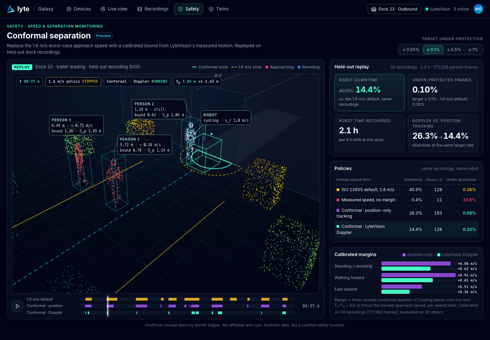

# Conformal separation: calibrated speed & separation monitoring from 4D coherent perception (Lyte concept)

**Live demo:** https://mohith26.github.io/lyte-conformal-separation/

Unofficial concept demo by Mohith Gajjela. Not affiliated with Lyte. Synthetic data. Not a certified safety function.

## What
Speed & separation monitoring (ISO/TS 15066) stops a robot when a person is closer than the protective separation distance
S_p = S_h + S_r + S_s + C + Z_d + Z_r. The human term S_h = v_h (T_r + T_s) usually takes the ISO 13855 default v_h = 1.6 m/s, so a person standing still 1.2 m from a loader stops it exactly like a person walking at it. ISO/TS 15066 allows a measured "directed speed" instead, but a raw measured speed is unsafe: people start, turn and accelerate inside the 0.6 s the robot needs to react and stop.

This demo turns LyteVision-style measured motion into a **calibrated bound**: the tracked approach speed plus a split-conformal margin, calibrated per speed state on recorded sessions, so that the person's actual closing speed over the reaction + stopping horizon exceeds the bound in at most a chosen fraction of frames (default 0.1%). It is shown as a Safety page in a Lyte console, replaying a trailer-loading dock (the use case Lyte named for the NVIDIA Halos Outside-In blueprint).

Held-out result on the seeded synthetic dock (30 calibration recordings, 30 test recordings, 2.5 h, 177k person-frames, target 0.1%):

| Human speed term | Robot downtime | Stops/h | Under-protected frames |
|---|---|---|---|
| ISO 13855 default 1.6 m/s | 40.9% | 129 | 0.28% |
| Measured speed, no margin | 0.4% | 11 | 33.8% |
| Conformal, position-only tracking | 26.3% | 183 | 0.09% |
| **Conformal, Doppler-aided tracking** | **14.4%** | 126 | **0.10%** |

`node scripts/summary.mjs [alpha]` reproduces the table. Two findings: the bound recovers about 2.1 h of robot time per 8 h shift at the same or lower under-protection than the 1.6 m/s default (which is not conservative for hurried workers), and measuring radial velocity directly (Doppler) shrinks the calibrated margin in every speed state versus differentiating positions, which is where most of the gain comes from.

## How it works
- **Dock simulation** (`core/ssm.mjs`, seeded): 3 workers per 5-minute recording walk between staging lanes and the loader with walk/slow/hurried legs (about 6% of legs above 1.6 m/s), acceleration limits, pauses and gait sway.
- **Sensing model**: per person per 10 Hz frame, a cluster centroid (6 cm noise) and the cluster's mean radial velocity relative to the sensor on the loader (4 cm/s noise). The page also renders per-point Doppler (limb motion included) for the replay view.
- **Tracking**: constant-velocity Kalman filter; the Doppler-aided version fuses the scalar radial-velocity measurement u . v each frame. Process noise is tuned per tracker on calibration recordings only.
- **Score**: for each frame within 8 m, s = (largest distance the person actually closes in the next T_r + T_s = 0.6 s) / 0.6 s − max(0, tracked approach speed).
- **Mondrian split conformal**: one finite-sample quantile (rank ceil((n+1)(1−α))) per speed state (standing/receding, walking toward, fast toward). Bound = max(0, v̂) + q̂_state, plugged into S_p.
- **Replay**: a protective stop starts when anyone is inside their S_p and ends after 1 s clear; downtime, stops/h and under-protected frames are counted per policy on the held-out recordings.

## Tests
`node --test` (9 tests): S_p formula; finite-sample conformal rank; coverage on exchangeable data (binomial check); Doppler-aided tracking beats position-only on approach speed, including during accelerations; closing-speed bookkeeping on a hand-built trajectory; per-state held-out coverage of the Mondrian bound; stop/restart hysteresis and counters; the end-to-end ordering (conformal Doppler keeps the target, beats the 1.6 m/s default on downtime and position-only tracking on downtime and margins); determinism.

## Honest limitations
- **Synthetic** people, sensor noise and dock. Real gait, occlusion, clustering errors and multi-person merges would change the margins; the method only promises what it calibrates on.
- **The guarantee is marginal and assumes exchangeability.** Consecutive frames are correlated and sites differ, so a deployment would need recording-level calibration, drift monitoring (e.g. adaptive conformal inference) and re-calibration per site.
- **Not a safety function.** A real one needs a safety-rated sensing and compute path (ISO 13849 PL d / IEC 62061), validated detection capability and a safety case; this is a statistical argument of the kind a SOTIF-style analysis could use, not a substitute for one.
- The robot is a fixed hazard point with constant v_r; real SSM uses the robot's current pose and speed.
- **UI:** no screenshots of a Lyte software console are public. The page uses Lyte's web design tokens (dark slate theme, #0053DF / #46FFC7 / #22d3ee accents) and the visual language of Lyte's own LyteVision renders and NVIDIA Halos infographic (range-colored points, thin teal PERSON/ROBOT boxes, yellow floor markings). Navigation labels are a plausible reconstruction.

## Novelty note
Dynamic SSM with measured human speed has been studied (NIST testbed 2012; Marvel & Norcross 2017), micro-Doppler has been used to tell humans from objects for SSM (IEEE Sensors 2019), and conformal prediction has been used for safe planning among people (e.g. Lindemann et al. 2023). I did not find a product or paper that calibrates the ISO/TS 15066 human-speed term with conformal prediction, or one that uses directly measured coherent-sensor radial velocity to tighten it. Lyte's public pages (Technology, NVIDIA Halos post, Holoscan and Scan to SimReady announcements, Series C release) describe measured motion and "fewer unnecessary stops" as goals but no calibrated separation feature.
